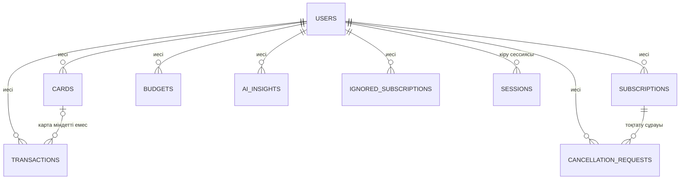

# Дерекқор құрылымы және ER сызбасы

Нақты құрылым `backend/finance/models.py` файлында, SQL нұсқасы `docs/schema.sql` файлында. Миграцияларды `python manage.py migrate` орындайды.

Барлық байланыс «бір-көп» және иесі бойынша: пайдаланушы өшірілсе, оның жазбалары да өшеді (`CASCADE`); карта өшірілсе, операция қалады, `card_id` бос болады (`SET_NULL`).

## Кестелер

| Кесте | Негізгі өрістер | Міндеті |
|---|---|---|
| users | id, name, email (бірегей), phone (бірегей), password_hash, email_verified_at, created_at | Аккаунт; құпиясөз тек хэш түрінде |
| sessions | token_hash, user_id, expires_at | Кіру сессиясы (токеннің хэші ғана сақталады) |
| email_challenges | purpose, email, code_hash, user_id, expires_at, attempts | Email растау және құпиясөзді қалпына келтіру кодтары |
| cards | id, user_id, bank_name, last4, status (active/inactive), created_at | Қолмен енгізілген карта белгісі (тек соңғы 4 сан) |
| transactions | id, user_id, card_id (бос болуы мүмкін), merchant, category, amount, type (income/expense), tx_date, created_at | Қаржы операциялары; кіріс пен шығыс бір кестеде |
| subscriptions | id, user_id, merchant, monthly_amount, next_payment, status (active/cancelled), created_at | Тұрақты төлемдер |
| budgets | id, user_id, category, monthly_limit, updated_at | Санат бойынша айлық лимит; (user, category) бірегей |
| cancellation_requests | id, user_id, subscription_id, status (requested/completed/withdrawn), created_at, updated_at | Жазылымды тоқтату туралы ішкі сұрау |
| ai_insights | id, user_id, period_start, period_end, rule_code, message, basis, created_at | Ережелік ұсыныстар тарихы; (user, rule_code, кезең) бірегей |
| ignored_subscriptions | id, user_id, key, created_at | «Ықтимал жазылымдар» тізімінде көрсетілмейтін сатушылар; (user, key) бірегей |

## Жоспардан айырмашылықтар (негізі мен салдары)

- **users атауы.** Жоспардағы `users` кестесі бар; Django моделі `Account`. Жолдар `full_name` емес, `name` деп аталады.
- **Бөлек `categories` кестесі жоқ.** Санат мәтін ретінде сақталады, бірақ түрі серверде тексеріледі: кіріске тек «Жалақы, Қосымша табыс, Сыйлық, Басқа», шығысқа тек «Азық-түлік, Көлік, Тамақтану, Тұрғын үй, Денсаулық, Ойын-сауық, Білім, Сауда, Басқа». Санат тізімін өзгерту код деңгейінде жасалады.
- **Ақша бүтін теңгемен сақталады** (`amount` бүтін сан), `DECIMAL` емес: қолданба тиын есептемейді. Бөлшек сома қажет болса, өріс түрін `DecimalField` етіп ауыстыру керек.
- **Жазылымдарда `card_id` және `billing_period` жоқ:** тек айлық төлем қарастырылады.
- **Уақыт мәндері** `DATE` (күн) және `DATETIME` (құрылған уақыт) түрінде.
